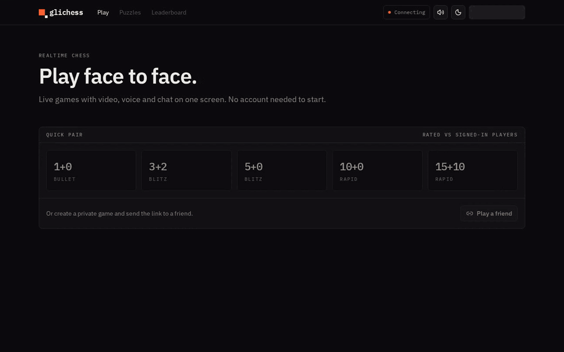
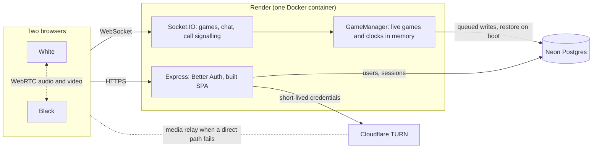

# glichess

Realtime chess with built-in video, voice and chat on one screen. Play as a guest or sign in with Google.



Guest or Google sign-in, invite links and quick pairing, server-side clocks with every end
condition, rematches, Glicko-2 ratings, chat, peer-to-peer video and voice, sounds, and a phone
layout.

## Stack

| Layer    | Tech                                                               |
| -------- | ------------------------------------------------------------------ |
| Web      | React 19, Vite, Tailwind CSS v4, shadcn/ui, React Router           |
| Server   | Express 5, Socket.IO, pino                                         |
| Data     | Neon Postgres, Drizzle ORM                                         |
| Realtime | Socket.IO for game state and signaling, WebRTC for media           |
| Chess    | chess.js (server-authoritative validation), react-chessboard       |
| Auth     | Better Auth (anonymous guests + Google)                            |
| Testing  | Vitest (engine, ratings, call sessions), Playwright (two browsers) |
| Tooling  | pnpm workspaces, TypeScript 7, Oxlint (type-aware), Oxfmt, Docker  |

## Architecture



The server is the single source of truth for each game: browsers send moves and render the
snapshots it broadcasts. Media is the exception, flowing directly between the two players (or
through Cloudflare's TURN relay) and never through the server.

## Layout

```
apps/
  web/        React SPA
  server/     Express + Socket.IO; serves the built SPA in production
packages/
  shared/     Socket event contracts and shared constants (TypeScript source, bundled by consumers)
  db/         Drizzle schema, migrations and client factory
```

The web app and API share one origin in every environment. In development Vite proxies `/api` and
`/socket.io` to the server; in production Express serves the built SPA. This keeps auth cookies
first-party without CORS configuration.

## Getting started

Requires Node 22.22+ and Corepack (ships with Node).

```sh
corepack enable          # uses the pnpm version pinned in package.json
pnpm install
cp .env.example .env
pnpm dev                 # web on http://localhost:5173, server on :3000
```

## Game server

- **Rules and clocks are server-side.** `apps/server/src/game/engine.ts` is a pure, synchronous
  engine (chess.js for move legality) that takes the current time as an argument, which makes
  clocks and every end condition unit-testable. Clients only render snapshots and send moves.
- **Clocks** start once both players have moved; until then each side has 30 seconds to make a
  first move or the game is aborted. A single timer per game fires at the next flag fall.
- **State** lives in memory for fast moves. Each change is queued to Postgres in order, unfinished
  games are restored on boot (downtime isn't charged to either clock), and pending writes are
  flushed on shutdown.
- **Presence**: if one player leaves an active game, the other wins by abandonment after 60 seconds
  unless they return.
- **Ratings** use Glicko-2 (`glicko2.ts`, tested against Glickman's worked example). Games are
  rated only when both players are signed in.

## Chat

- Each game has a chat for its two players. Messages are delivered to the players' own Socket.IO
  rooms rather than the game room, so spectators never receive them, and the server checks the
  sender's seat on every read and write.
- Messages are stored in Postgres (`game_messages`) and the client reloads the latest 200 after
  every reconnect, so nothing is lost across reloads or dropped connections. Sends are optimistic.
- The server trims and collapses whitespace, caps messages at 280 characters and rate-limits
  each user with a token bucket (a burst of 5, then one every 2 seconds).
- Game events (draw and rematch offers, a player leaving, the result) appear as notices among the
  messages. Players can mute their opponent's messages; the choice is kept in the browser.

## Video and voice

- Peer-to-peer WebRTC between the two players, signalled over the existing Socket.IO connection.
  The server only relays messages between the two seats; media never passes through it.
- `apps/server/src/rtc/calls.ts` tracks which tab holds each player's seat in the call. Every
  change (join, leave, reconnect, a second tab taking over) starts a new session number, so both
  browsers drop their old peer connection and any signals still in flight for it.
- Browsers use the "perfect negotiation" pattern (`apps/web/src/lib/call/call-session.ts`). White
  creates the audio and video transceivers up front; camera and mic are switched with
  `replaceTrack`, so toggling a device never renegotiates. Failed connections retry with ICE
  restarts.
- TURN relays come from Cloudflare: the server mints short-lived credentials on each call join, so
  calls connect even behind strict NATs. Without a key configured, calls fall back to STUN only.
- Camera and mic start on in invite games and off in quick-paired games. The choice is kept per
  game in session storage and carried into rematches. A speaking indicator uses the Web Audio API.

## Sounds and phones

- Moves, captures, checks, the start of a game and its result (victory, defeat or draw) play
  short sounds through the Web Audio API, preloaded and decoded once. New chat messages play a
  quieter chime. A header button turns sounds off, and the setting syncs across tabs.
- The sounds are lichess's "piano" set by Enigmahack, licensed AGPLv3+; see
  `apps/web/public/sounds/LICENSE.md`.
- On phones the call sits in a compact panel above the board, and moves and chat share tabs below
  it, with an unread badge on Chat.

## Authentication

Better Auth runs inside the Express server and stores users and sessions in Neon via Drizzle.

- Every visitor is signed in as a guest on first load (Better Auth's anonymous plugin), with a
  generated name such as `SwiftRook482`.
- "Sign in with Google" links the guest to a Google account. The `onLinkAccount` hook
  (`apps/server/src/auth/link-guest.ts`) moves the guest's games and messages to the account
  before the guest user is deleted.
- Socket.IO connections are authenticated from the same session cookie during the handshake;
  connections without a session are rejected.

## Maintenance

- Every six hours the server removes guest accounts whose sessions have all expired (a guest has
  no password or provider, so it can never be signed into again), games left with no player, and
  expired sessions. Finished games keep a removed guest's name. See
  `apps/server/src/maintenance/cleanup.ts`.
- Render's free tier sleeps after 15 idle minutes. `.github/workflows/keep-alive.yml` pings
  `/api/health` every 10 minutes once the `APP_URL` repository variable is set. The health route
  never touches the database, so the pings don't keep Neon awake.

## Testing

- `pnpm test` runs the Vitest unit tests: the game engine and clocks, Glicko-2, matchmaking, the
  rate limiter, chat normalisation and call sessions.
- `pnpm test:e2e` runs Playwright against the dev servers (it starts them if they aren't
  running). Two browsers play an invite game with moves, sounds, chat, mute, a draw offer,
  resignation and a rematch; pair through the quick queue; hold a video call using Chromium's fake
  camera and microphone; and check the phone layout. Run `pnpm exec playwright install chromium`
  once first.
- CI runs format, lint, typecheck, unit tests and the build, and a second job runs the end-to-end
  tests against a throwaway Postgres container.

## Environment

| Variable                                    | Purpose                                                               |
| ------------------------------------------- | --------------------------------------------------------------------- |
| `DATABASE_URL`                              | Neon pooled connection string (runtime)                               |
| `DATABASE_URL_DIRECT`                       | Neon direct connection string (migrations)                            |
| `BETTER_AUTH_URL`                           | Public origin of the app (`http://localhost:5173` in dev)             |
| `BETTER_AUTH_SECRET`                        | Session signing secret (`openssl rand -base64 32`)                    |
| `GOOGLE_CLIENT_ID` / `GOOGLE_CLIENT_SECRET` | Google OAuth client; redirect URI `<origin>/api/auth/callback/google` |
| `CLOUDFLARE_TURN_KEY_ID` / `_API_TOKEN`     | Cloudflare Realtime TURN key (optional; STUN only without it)         |
| `RUN_MIGRATIONS`                            | Apply migrations on boot (defaults to `true` in production)           |

## Scripts

| Command                           | What it does                                                |
| --------------------------------- | ----------------------------------------------------------- |
| `pnpm dev`                        | Run web and server with hot reload                          |
| `pnpm build`                      | Build every package                                         |
| `pnpm start`                      | Run the built server (serves the web build)                 |
| `pnpm test` / `pnpm test:e2e`     | Unit tests (Vitest) / end-to-end tests (Playwright)         |
| `pnpm lint` / `pnpm typecheck`    | Static checks                                               |
| `pnpm format`                     | Format with Oxfmt (also sorts imports and Tailwind classes) |
| `pnpm db:generate` / `db:migrate` | Create and apply Drizzle migrations                         |

## Deployment

The `Dockerfile` builds a single image containing the server and the static web build. `render.yaml`
deploys it to Render's free tier. Neon and Cloudflare TURN also have free tiers that cover a demo
deployment. To keep the free instance awake, add the deployed origin as the `APP_URL` Actions
variable in the GitHub repository settings.

```sh
docker build -t glichess .
docker run -p 3000:3000 --env-file .env -e NODE_ENV=production glichess
```

## Notes

- After `pnpm dlx shadcn add <component>` in `apps/web`, check the generated `cn` import points to
  `@/lib/utils`. The CLI can misresolve the alias in this workspace layout.
